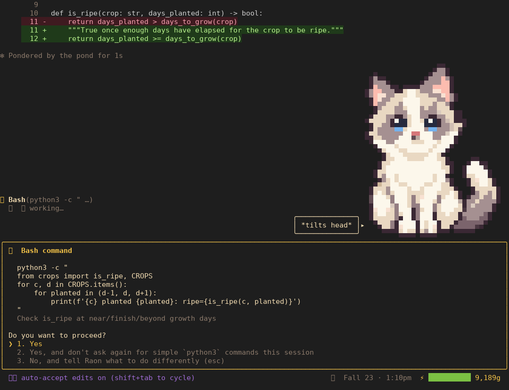

<p align="center"></p>
<p align="center"><b>A cozy coding agent for your terminal, powered by Raon.</b></p>

## Install

You need Node.js 22.12+ and a Raon API key.

```sh
npm install -g github:albusdemens/zoicode
```

Then run `raoncode` in your project folder. The first time, it asks for your API key and saves it
to `~/.raoncode/.env`. You can also set `RAON_API_KEY` instead.

Maximize your terminal first: the opening scene needs 116×42.

<p align="center"></p>

## Use

Type what you want. Raon reads and edits code and runs commands, and asks before changing anything.

- `Shift+Tab` cycles the modes (default → auto-accept edits → plan) · `Esc` interrupts Raon · `Ctrl+C` twice quits
- `!cmd` runs a shell command · `#note` saves a note to `RAONCODE.md` · `@file` attaches a file · `/help` lists the commands
- `raoncode -c` continues the last session · `raoncode -p "…"` answers once and exits, for scripts

Everything else is in the [guide](docs/GUIDE.md).

## Develop

```sh
git clone https://github.com/albusdemens/zoicode.git && cd zoicode
npm install && npm link    # builds, then puts raoncode on your PATH
npm test
```
