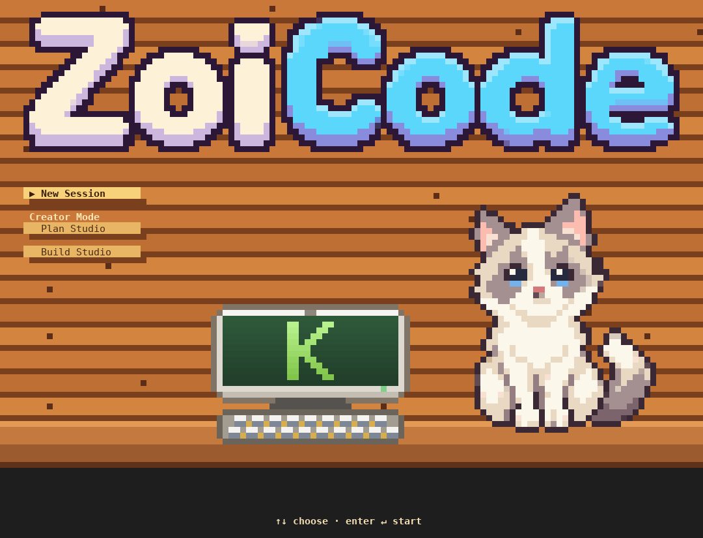

# Zoi Code guide

Install instructions are in the [README](../README.md).

## The opening screen

<p align="center">
  
  
</p>

The opening screen has a small menu. Use ↑↓ and Enter:

- **New Session** starts fresh.
- **Continue** resumes the last session in this folder.
- **Plan Studio** starts in plan mode.
- **Build Studio** starts with file edits auto-accepted.

Then the cat hops down onto your prompt and keeps you company. It mostly sits still, with an
occasional blink or tail flick. `--no-splash` skips the opening.

## What it can do

- **Work on your code.** Raon reads files, searches the project (Glob, Grep, LS), edits and writes
  files (showing a colored diff), runs shell commands, and fetches web pages. Replies stream in
  with Markdown and syntax highlighting.
- **Ask first.** Anything that changes files, runs a command or goes online needs your approval,
  unless you allow it for the session. Read-only commands such as `ls`, `cat`, `git status` or
  `git diff` run without asking.
- **Plan before building.** Shift+Tab cycles through the modes: *default* → *auto-accept edits*
  → *plan*. In plan mode Raon only researches, then shows a plan for you to approve.
- **Track its work.** Bigger tasks get a to-do list (the Quest Log), and Raon can hand searches
  off to subagents that have their own context.
- **Remember.** Sessions are saved per folder: `zoicode -c` continues the last one, and
  `zoicode -r` lists them. Project notes in `ZOICODE.md` (or `CLAUDE.md`) are loaded into every
  conversation. `/init` writes one, and a line starting with `#` adds a note.
- **Stay within the context window.** The conversation is compacted automatically near the
  model's context limit; `/compact` does it on demand.
- **Run in scripts.** `zoicode -p "…"` prints the answer and exits, with plain text, JSON or
  streaming JSON output.

## Using it

### Keys

| Key | What it does |
|-----|--------------|
| Enter | Send the message. While Raon works, it queues the message for later. |
| `\` then Enter | Start a new line |
| ↑ / ↓ | Go through your previous messages |
| Tab | Complete a `/command` |
| Esc | Interrupt Raon, or clear the input |
| Ctrl+C | Interrupt; press it twice to quit |
| Shift+Tab | Switch mode: default → auto-accept edits → plan |
| Ctrl+A / E / U / K / W | Start / end of line, delete before / after the cursor, delete a word |

Start a line with:

- `!` to run a shell command yourself (`!git log --oneline -5`). Raon sees the output.
- `#` to save a note to `ZOICODE.md`.

Add `@path/to/file` anywhere in a message to attach that file.

### Slash commands

| Command | |
|---------|---|
| `/help` | Commands and shortcuts |
| `/clear` | Start a fresh conversation |
| `/compact [focus]` | Summarize the conversation to free up context |
| `/cost` | Token usage for this session |
| `/model [name]` | Show or switch the model |
| `/init` | Write a `ZOICODE.md` describing this project |
| `/memory` | Show which memory files are loaded |
| `/permissions` | Show the current mode and the rules you've allowed |
| `/resume [id]` | List saved sessions, or resume one |
| `/export [file]` | Save the conversation as Markdown |
| `/pet` | Pet the cat |
| `/exit` | Quit |

**Your own commands:** put a Markdown file in `.zoicode/commands/` (for the project) or
`~/.zoicode/commands/` (for all projects). `review.md` becomes `/review`, and `$ARGUMENTS` in the
file is replaced by whatever you type after the command. An optional `description:` in YAML
front matter shows up in `/help`. Commands from `.claude/commands/` work too.

### Command line

```
zoicode [prompt]                 start (optionally with a first message)
zoicode -p "prompt"              print the answer and exit; piped stdin is added to the prompt
    --output-format text|json|stream-json
    --verbose                     show tool calls and reasoning on stderr
zoicode -c                       continue the most recent session in this folder
zoicode -r [id]                  resume a session (without an id: list them)
zoicode --permission-mode default|acceptEdits|plan|bypass
zoicode --yolo                   never ask for permission (same as --permission-mode bypass)
zoicode -m <model>               use another model
zoicode --no-splash              skip the opening scene
zoicode --setup                  enter or change the API key
```

In `-p` mode nobody can answer a permission prompt, so anything that would ask is refused.
Add `--permission-mode acceptEdits` to let it edit files, or `--yolo` to allow everything.

### Permissions and safety

- **Approvals.** Reading and searching never ask. Writing, editing, running commands and fetching
  web pages ask unless you've allowed them.
- **"Don't ask again" rules last for the session and stay narrow.** A Bash rule covers only simple
  commands of that program (`npm …`, never `npm … && rm …`). Edit rules and auto-accept mode only
  cover files inside the project folder.
- **No credentials from projects.** Configuration is never read from the project's `.env`, so a
  repository can't redirect your API key to another server.
- **Clean display.** Commands, paths and output chosen by the model are cleaned of terminal
  escape codes before they are shown, so an approval prompt always shows exactly what will run.

## Configuration

Set these in your environment or in `~/.zoicode/.env`:

| Variable | Default | |
|----------|---------|---|
| `RAON_API_KEY` | (required) | Your API key |
| `RAON_BASE_URL` | `https://raon-api.krafton.ai/v1` | Any OpenAI-compatible endpoint works |
| `RAON_MODEL` | `raon-1-mini-preview` | |
| `RAON_CONTEXT_WINDOW` | `262144` | In tokens, e.g. `131072` or `128k`; sets when auto-compaction starts |

Zoi Code keeps its files in `~/.zoicode/`:

- `.env`: your key.
- `projects/<folder>/<id>.json`: saved sessions.
- `ZOICODE.md`: notes for every project.
- `commands/`: your slash commands.

## Development

```sh
npm install          # dependencies
npm run dev          # run from source with tsx
npm run build        # bundle src/ into dist/cli.js with esbuild
npm run typecheck
npm test             # unit and integration tests
```

`dist/cli.js` is committed, so `npm install -g https://github.com/albusdemens/zoicode/archive/refs/heads/main.tar.gz` works without a build step
on the user's machine: run `npm run build` before committing changes to `src/`.

It is written in TypeScript with [Ink](https://github.com/vadimdemedes/ink) (React for the
terminal), like Claude Code, and talks to Raon through the OpenAI SDK.

**Tools for working on the interface.** They need Python 3 with `pip install pyte pillow numpy`:

- `test/tui.py` runs Zoi Code in a pseudo-terminal, types keys and saves screenshots. Example:
  `python3 test/tui.py <folder> wait:2 "hello<enter>" until:Thought shot:out.png`
- `test/termshot.py` renders terminal output to a PNG.
- `scripts/scene-preview.ts` renders the opening scene's frames.
- `scripts/sprite-preview.ts` validates and renders the sprites.
- `scripts/import-art.py` converts upscaled pixel art (like the images in `art/`) into sprites.
  See [src/ui/sprites/README.md](../src/ui/sprites/README.md).
- `scripts/graphics-check.ts` reports which image protocols your terminal supports.

```
src/
  cli.tsx            command line: flags, interactive or -p mode
  agent.ts           the agent loop: tools, permissions, plan mode, subagents, compaction
  llm.ts             streaming client for the OpenAI-compatible API
  prompt.ts          system prompt and memory files
  config.ts setup.ts sessions.ts headless.ts
  tools/             Read Write Edit Bash Glob Grep LS WebFetch TodoWrite Task ExitPlanMode
  ui/
    App.tsx          the session screen (Ink)
    opening.ts       the opening scene, drawn straight to the terminal
    scene.ts         layout and painting of the scene
    canvas.ts        half-block pixel compositor
    Cat.tsx catAnim.ts   the cat and its animation
    sprites/         pixel art: cat, logo, computer
art/                 original artwork the sprites come from
scripts/             art import and preview tools
test/                tests, plus the pseudo-terminal harness
```

## Credits

The interface is inspired by [Claude Code](https://github.com/anthropics/claude-code), and the look by Stardew Valley.
Zoi Code is an independent project, not affiliated with either. The logo and cat artwork are in `art/`.
